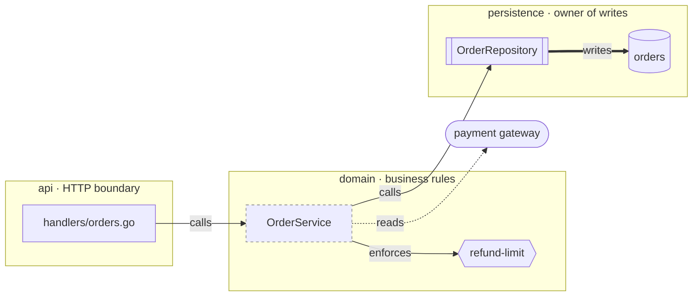
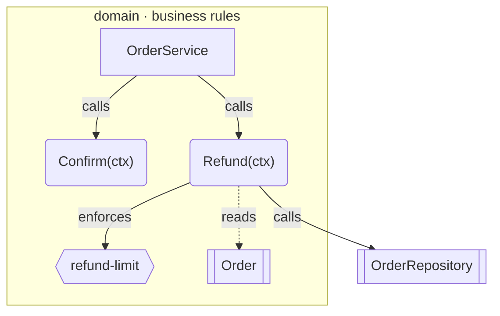
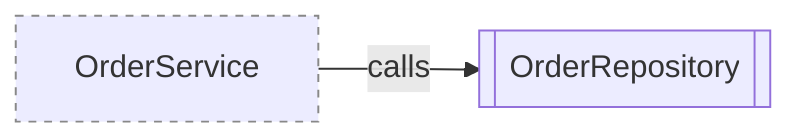

# Plan diagram skeletons

Copy one, replace the nodes with real paths and symbols, keep the shapes.

## L2 — containers and boundaries

Question: *who may write to the `orders` store?*



## L3 — components inside one container

Question: *where does the refund guard sit inside `domain`?*



## ASCII fallback

Only for destinations without a renderer. Same nodes, same edge verbs.

```
            +--- api ------------------+
            |  handlers/orders.go      |
            +-------------+-----------+
                          | calls
            +--- domain ---v-----------+
            |  OrderService            |
            |    | enforces            |
            |    v                     |
            |  < refund-limit >        |
            +-------------+------------+
                          | calls
            +--- persistence ----------+
            |  [OrderRepository]       |
            |        | writes          |
            |        v                 |
            |      (orders)            |
            +--------------------------+

  [ ]  file/module      { }  policy
  [x]  class/contract   ( )  method
  (x)  store            < >  assumption
```

## Assumptions

One class only, on assumptions, never on real nodes. The line below is a
fragment, not a diagram — paste it inside an existing `flowchart` block:

```text
classDef assumed stroke-dasharray:4 4,stroke:#888
```

Apply it with `:::assumed` on a node that already has a shape, then state the
assumption in the artifact's own words below the diagram — the dashed border is
a flag, not an explanation.


